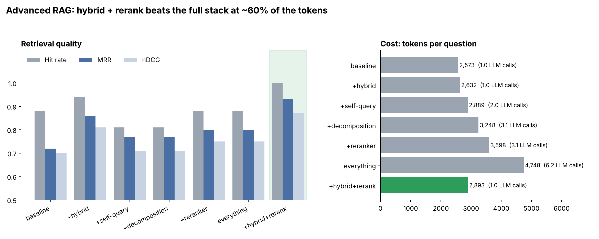
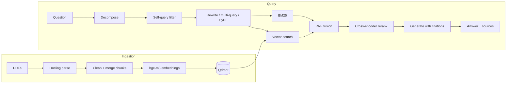

# Advanced RAG

An experimentation notebook that builds a full RAG stack over your own PDFs, then **measures** which retrieval techniques actually help, and what each one costs in time, tokens and LLM calls.

Every technique is a switch in a single `Config`. The notebook runs a ladder of configurations over a golden question set and writes the results to one scorecard, so you choose a pipeline from evidence instead of intuition.



## Key findings

On my own run (two technical PDFs, not included in this repo):

- **Hybrid search + a cross-encoder reranker was the best configuration**: every question had all of its evidence retrieved (`complete` = 1.00), with MRR 0.93 and nDCG 0.87, using a single LLM call.
- **Adding more techniques did not mean better retrieval.** Self-query and decomposition lowered the scores compared with plain hybrid search, and turning everything on cost the most (about 4,750 tokens and 6.2 LLM calls per question) without beating the simple setup.
- **Hybrid search alone was a cheap win** over the vector-only baseline (`complete` 0.88 to 0.94 at almost the same token cost).

These numbers come from a small golden set, so treat a difference of one question as noise (see [Limitations](#limitations)).

## Results

Quality is measured on the chunks that were actually sent to the LLM. Cost is the average per question.

| Config | hit_rate | recall | mrr | ndcg | complete | seconds | tokens | LLM calls |
|---|---|---|---|---|---|---|---|---|
| baseline (vector only) | 0.88 | 0.78 | 0.72 | 0.70 | 0.88 | 19.3 | 2,573 | 1.0 |
| + hybrid | 0.94 | 0.84 | 0.86 | 0.81 | 0.94 | 31.0 | 2,632 | 1.0 |
| + self-query | 0.81 | 0.72 | 0.77 | 0.71 | 0.81 | 29.1 | 2,889 | 2.0 |
| + decomposition | 0.81 | 0.72 | 0.77 | 0.71 | 0.81 | 31.8 | 3,248 | 3.1 |
| + reranker | 0.88 | 0.78 | 0.80 | 0.75 | 0.88 | 32.4 | 3,598 | 3.1 |
| everything | 0.88 | 0.78 | 0.80 | 0.75 | 0.88 | 42.7 | 4,748 | 6.2 |
| **+ hybrid + rerank** | **1.00** | **0.91** | **0.93** | **0.87** | **1.00** | 28.8 | 2,893 | 1.0 |

The raw table is in [`experiments/scorecard.csv`](experiments/scorecard.csv).

Notes on reading it:

- The ladder is cumulative: each row turns on one more flag than the row above it, so `+ reranker` includes hybrid, self-query and decomposition. `+ hybrid + rerank` branches off `+ hybrid` and was added after reading the ladder.
- `seconds` is noisy. LLM step timings are cached from the first run and local models share one machine, so tokens and LLM calls are the more reliable cost signals.
- `scorecard.csv` holds retrieval and cost metrics. The notebook also contains Ragas answer-level evaluation, which you can add to the scorecard.

## The configurations

| Flag | What it does |
|---|---|
| `retriever` | `vector` (bge-m3 in Qdrant), `bm25`, or `hybrid` (both merged with Reciprocal Rank Fusion) |
| `self_query` | An LLM reads the list of documents and decides whether the question targets one specific document. If so, the search is filtered to that document |
| `query_steps` | Any of `decompose`, `rewrite`, `multi_query`, `hyde` |
| `rerank` | `bge` (bge-reranker-v2-m3) or `minilm`, applied to the top `rerank_depth` candidates |
| `k` | How many chunks per sub-question go to the LLM |

## How it works



Every query-side stage is optional and controlled by `Config`.

Highlights:

- **Ingestion:** Docling converts each PDF (cached on disk), then a custom chunker enforces a 1,024-token maximum (measured with the bge-m3 tokenizer), merges fragments under 250 tokens into the next chunk of the same section, and drops trivial fragments. Front and back matter and misparsed headings are removed. Each chunk carries headings, page range, table/code/formula flags and previous/next links.
- **Collection is built once.** If the Qdrant collection already exists, ingestion is skipped (`REBUILD = False`).
- **`@step` decorator:** every pipeline step records its time and tokens in a per-question trace, and LLM steps are cached in `experiments/steps.json`, so re-running the notebook does not call the LLM again.
- **Resumable runs:** answers are saved in `experiments/answers.jsonl` under a key made of config, question id and question text. Re-running only computes new or edited questions, and a failed question is retried next time.
- **Grounded answers:** the generator answers only from numbered sources, cites them, and returns a fixed refusal sentence when the sources do not contain the answer. An optional refusal gate skips the LLM entirely when the best reranker score is below a threshold.

## Tech stack

| Area | Tools |
|---|---|
| PDF parsing and chunking | Docling (`HybridChunker`), Hugging Face tokenizer |
| Embeddings | `BAAI/bge-m3` (1024-dim, cosine) |
| Vector database | Qdrant (Docker) |
| Keyword search | `rank_bm25` with a Unicode-aware tokenizer |
| Reranking | `BAAI/bge-reranker-v2-m3` via `sentence-transformers` (MiniLM as a lighter option) |
| LLM | Groq (`openai/gpt-oss-120b`) through LangChain |
| Retrieval evaluation | `ranx` (hit rate, recall, MRR, nDCG) |
| Answer evaluation | Ragas (faithfulness, factual correctness, context precision and recall) |
| Data and tooling | pandas, tqdm, Docker Compose |

## Repository structure

```
.
├── rag_experiments.ipynb      # the whole experiment, one idea per cell
├── docker-compose.yml         # local Qdrant
├── data/
│   └── golden_fina.csv        # your golden set (the path the notebook reads)
├── experiments/
│   └── scorecard.csv          # final comparison table
└── assets/
    └── scorecard.png
```

Put your PDFs in `data/` as well. They are not tracked.

## Quick start

1. **Start Qdrant**

   ```bash
   docker compose up -d
   ```

   The dashboard is at <http://localhost:6333/dashboard>.

2. **Install dependencies** (the same line is at the top of the notebook)

   ```bash
   pip install -q docling docling-core transformers qdrant-client langchain-core \
       langchain-huggingface langchain-groq rank-bm25 sentence-transformers ranx \
       "ragas==0.4.3" openai pandas tqdm
   ```

3. **Set your Groq key**

   ```bash
   export GROQ_API_KEY=your_key_here
   ```

   If the variable is not set, the notebook asks for the key when it reaches the LLM cell.

4. **Add your documents and golden set**: copy your PDFs into `data/`, then fill in the golden set (next section).

5. **Run `rag_experiments.ipynb` top to bottom.** The first run downloads the embedding and reranker models and converts the PDFs; later runs reuse the caches.

Useful settings, all in the first code cell: `REBUILD` (rebuild the collection after changing chunking), `WORKERS` (questions run in parallel; lower it if Groq rate limits you) and `SAMPLE` (run only the first N questions for a quick trial).

## Use your own content: the golden set

The golden set is a CSV that tells the notebook which questions to ask and what evidence the right chunks must contain. Start from [`data/golden_template.csv`](data/golden_template.csv): copy it to the path set in `GOLDEN_PATH` (default `data/golden_fina.csv`), delete the three `EX` example rows and add your own.

| Column | Required | Meaning |
|---|---|---|
| `id` | yes | Unique id per question (for example `Q001`) |
| `type` | yes | A free label such as `factual`, `compound` or `out_of_scope`. Used for the per-type breakdown tables |
| `question` | yes | The question exactly as a user would ask it |
| `evidence` | yes* | A short passage copied **verbatim** from your document that proves the answer. Several pieces are separated by `\|\|`. Leave it empty for a question that should be refused |
| `reference_answer` | yes | The ideal answer. Used by Ragas. For refusal questions use `I don't know based on the documents.` |
| `should_refuse` | no | `True` or `False`. If the column is missing it is computed from an empty `evidence` |

\* empty on purpose for questions that must be refused.

Rules that make the evaluation reliable:

- **Evidence is matched as a substring** of a chunk, ignoring case and extra whitespace. Copy it exactly from the source and keep it short (roughly 5 to 15 words).
- **Each piece of evidence must sit inside one chunk.** A passage that crosses a chunk boundary will never match.
- **Avoid evidence taken from tables, code blocks or hyphenated line breaks**, because parsing can change that text.
- **Compound questions** (several things in one question) get one evidence piece per part, joined with `||`. `recall` counts how many pieces were found and `complete` counts questions where all of them were.
- **Add some out-of-scope questions** with empty evidence. They test that the system refuses instead of making things up.

## Metrics

| Metric | Question it answers |
|---|---|
| `hit_rate` | Did any evidence reach the LLM? |
| `recall` | What share of the evidence pieces were found? |
| `mrr` / `ndcg` | How high were the evidence chunks ranked? |
| `complete` | In what share of questions was **all** the evidence found? |
| `seconds`, `tokens`, `llm_calls`, `chunks` | Average cost per question |
| Ragas: `faithfulness`, `factual_correctness`, `context_precision`, `context_recall` | Is the final answer grounded, correct and supported by relevant context? (LLM judge) |

## Challenges and lessons

- **Messy PDF parsing.** Docling sometimes misreads callout words and font styles as headings and returns front matter, tables of contents and publisher boilerplate as content. Fixed with a noise-heading list, section filters, automatic detection of the first content page and a merge step for tiny chunks.
- **Rate limits.** Parallel questions hit the Groq rate limit. Handled with a configurable worker count, automatic retries, and resumable runs so a failed question never forces a full rerun.
- **Fair measurements.** Local models share one machine, so they run behind a lock and each step is timed on its own. Context variables had to be copied into worker threads so traces were not lost.
- **Multilingual text.** A simple regex tokenizer would strip non-Latin scripts, so BM25 uses a Unicode-aware `\w+` tokenizer, and the manual test table includes a cross-lingual question.
- **Cost of evaluation.** The LLM judge makes several calls per question, so you choose which configurations to score.
- **Surprising results.** The two techniques I expected to help most (self-query and decomposition) hurt on this data. One plausible reason is that a wrong document filter removes the right chunks, but I have not diagnosed this. Measuring first is what exposed it.

## Limitations

- The golden set is small, so one question moves the scores by several points. Differences between neighbouring configurations may be noise.
- The golden set was built from the same documents it evaluates, with LLM help. Review it before trusting the numbers.
- Results are from two technical PDFs in English. Other domains, languages and document types may rank the configurations differently.
- Wall-clock times are approximate (cached LLM timings, shared local hardware).

## Ideas for next steps

- Add the Ragas answer-quality columns to the committed scorecard.
- Grow the golden set and report confidence intervals.
- Diagnose why self-query and decomposition lowered retrieval quality.
- Serve the best configuration behind an API.
